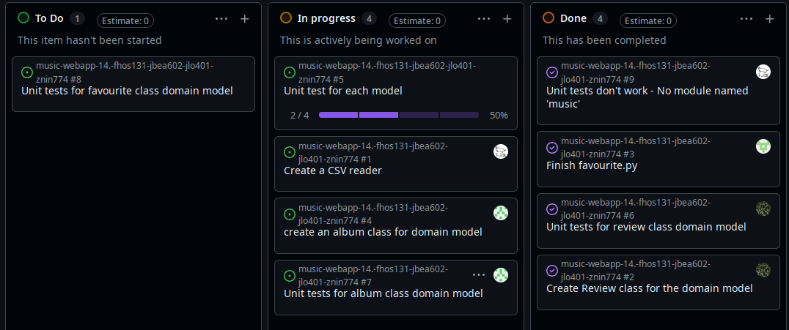

 # Weekly Checkin 03

**Team Name:** (fhos131-jbea602-jlo401-znin774)

**GitHub Repo Link:** https://github.com/UoA-CS-Project-CS235-S2-2026/music-webapp-14.-fhos131-jbea602-jlo401-znin774

**Submitted by:** Finn Hoskin

**Team Members (name + GitHub handle):**
- Finn — @BlueFinnTuna
- Joshua — @odmot
- Jono — @JonoBeach
- Zhuoyi — @ning12-3

**Participants this week:** 
Everyone has worked on the assignment this week

**How we synced:** Discord and briefly in person during lectures a few days this week

## Discussion / Decisions
- Using a user_id field in domain classes to refer to specific users, because we were having circular import errors when importing the User class.
- Aiming to finish part 1 this weekend so we can get started on part 2 soon.

## Action Items
| Task | Owner | Due | Linked Issue | Status |
|---|---|---|---|---|
|Unit test for Favourite class||| [#8](https://github.com/UoA-CS-Project-CS235-S2-2026/music-webapp-14.-fhos131-jbea602-jlo401-znin774/issues/8) |Not Started|
|Unit test for Album class|Zhuoyi|Aug.30| [#7](https://github.com/UoA-CS-Project-CS235-S2-2026/music-webapp-14.-fhos131-jbea602-jlo401-znin774/issues/7) |In Progress|
|Unit test for each model||Aug.30| [#5](https://github.com/UoA-CS-Project-CS235-S2-2026/music-webapp-14.-fhos131-jbea602-jlo401-znin774/issues/5) |In Progress|
|Create a CSV reader|Joshua|Aug.30| [#1](https://github.com/UoA-CS-Project-CS235-S2-2026/music-webapp-14.-fhos131-jbea602-jlo401-znin774/issues/1) |In Progress|
|Create album class|Zhuoyi|Aug.30| [#4](https://github.com/UoA-CS-Project-CS235-S2-2026/music-webapp-14.-fhos131-jbea602-jlo401-znin774/issues/4) |In Progress|
|Create unit tests for Review class|Finn|Aug.28| [#6](https://github.com/UoA-CS-Project-CS235-S2-2026/music-webapp-14.-fhos131-jbea602-jlo401-znin774/issues/6) |Done|
|Create Review class|Finn|Aug.28| [#2](https://github.com/UoA-CS-Project-CS235-S2-2026/music-webapp-14.-fhos131-jbea602-jlo401-znin774/issues/2) |Done|
|Finish favourite.py|Jono|Aug.28| [#3](https://github.com/UoA-CS-Project-CS235-S2-2026/music-webapp-14.-fhos131-jbea602-jlo401-znin774/issues/3) |Done|
|Unit tests not working|Joshua|Aug.28| [#9](https://github.com/UoA-CS-Project-CS235-S2-2026/music-webapp-14.-fhos131-jbea602-jlo401-znin774/issues/9) |Done|

## Board Snapshot

