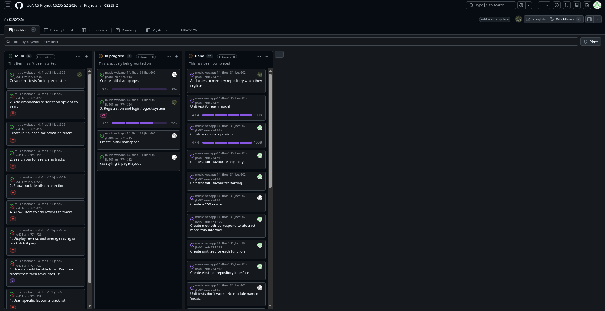

# Weekly Checkin 04

**Team Name:** (fhos131-jbea602-jlo401-znin774)

**GitHub Repo Link:** https://github.com/UoA-CS-Project-CS235-S2-2026/music-webapp-14.-fhos131-jbea602-jlo401-znin774

**Submitted by:** Zhuoyi Ning

**Team Members (name + GitHub handle):**
- Finn — @BlueFinnTuna
- Joshua — @odmot
- Jono — @JonoBeach
- Zhuoyi — @ning12-3

**Participants this week:** Everyone has worked on the assignment this week

**How we synced:** Communication takes place primarily via Discord this week.

## Discussion / Decisions
- Adding a data field review list to the Track class for better data management.
- Discussed how the memory repository works with the abstract repository interface and which methods need to be implemented.
- Discussed how the favourite ID works and the Favourite class’s relation to User and Track. Adding a favourite should not create another favourite that has the same track in the memory repository.
- Some discussion about how the issues are assigned.

## Action Items
| Task | Owner | Due | Linked Issue | Status |
|---|---|---|---|---|
|User-specific favourite track list||| [#27](https://github.com/UoA-CS-Project-CS235-S2-2026/music-webapp-14.-fhos131-jbea602-jlo401-znin774/issues/27) [#28](https://github.com/UoA-CS-Project-CS235-S2-2026/music-webapp-14.-fhos131-jbea602-jlo401-znin774/issues/28) |To Do|
|Display reviews and average rating on track detail page|||[#26](https://github.com/UoA-CS-Project-CS235-S2-2026/music-webapp-14.-fhos131-jbea602-jlo401-znin774/issues/26)|To Do|
|Allow users to add reviews to tracks| | | [#25](https://github.com/UoA-CS-Project-CS235-S2-2026/music-webapp-14.-fhos131-jbea602-jlo401-znin774/issues/25) |To Do|
|Show track details on selection||| [#23](https://github.com/UoA-CS-Project-CS235-S2-2026/music-webapp-14.-fhos131-jbea602-jlo401-znin774/issues/23) |To Do|
|Search bar for searching tracks||| [#21](https://github.com/UoA-CS-Project-CS235-S2-2026/music-webapp-14.-fhos131-jbea602-jlo401-znin774/issues/21) |To Do|
|Add dropdowns or selection options to search||| [#22](https://github.com/UoA-CS-Project-CS235-S2-2026/music-webapp-14.-fhos131-jbea602-jlo401-znin774/issues/22) |To Do|
|Create initial webpages|Joshua|| [#14](https://github.com/UoA-CS-Project-CS235-S2-2026/music-webapp-14.-fhos131-jbea602-jlo401-znin774/issues/14) [#15](https://github.com/UoA-CS-Project-CS235-S2-2026/music-webapp-14.-fhos131-jbea602-jlo401-znin774/issues/15) [#16](https://github.com/UoA-CS-Project-CS235-S2-2026/music-webapp-14.-fhos131-jbea602-jlo401-znin774/issues/16) [#32](https://github.com/UoA-CS-Project-CS235-S2-2026/music-webapp-14.-fhos131-jbea602-jlo401-znin774/issues/32) |In Progress|
|Registration and login/logout system|Finn|| [#24](https://github.com/UoA-CS-Project-CS235-S2-2026/music-webapp-14.-fhos131-jbea602-jlo401-znin774/issues/24) [#29](https://github.com/UoA-CS-Project-CS235-S2-2026/music-webapp-14.-fhos131-jbea602-jlo401-znin774/issues/29) [#30](https://github.com/UoA-CS-Project-CS235-S2-2026/music-webapp-14.-fhos131-jbea602-jlo401-znin774/issues/30) [#34](https://github.com/UoA-CS-Project-CS235-S2-2026/music-webapp-14.-fhos131-jbea602-jlo401-znin774/issues/34) [#31](https://github.com/UoA-CS-Project-CS235-S2-2026/music-webapp-14.-fhos131-jbea602-jlo401-znin774/issues/31) |In Progress|
|Create memory repository|Ning|| [#17](https://github.com/UoA-CS-Project-CS235-S2-2026/music-webapp-14.-fhos131-jbea602-jlo401-znin774/issues/17) [#18](https://github.com/UoA-CS-Project-CS235-S2-2026/music-webapp-14.-fhos131-jbea602-jlo401-znin774/issues/18) [#19](https://github.com/UoA-CS-Project-CS235-S2-2026/music-webapp-14.-fhos131-jbea602-jlo401-znin774/issues/19) [#20](https://github.com/UoA-CS-Project-CS235-S2-2026/music-webapp-14.-fhos131-jbea602-jlo401-znin774/issues/20) [#33](https://github.com/UoA-CS-Project-CS235-S2-2026/music-webapp-14.-fhos131-jbea602-jlo401-znin774/issues/33)|Done|
|Unit test for Favourite class|Jono|| [#8](https://github.com/UoA-CS-Project-CS235-S2-2026/music-webapp-14.-fhos131-jbea602-jlo401-znin774/issues/8) [#12](https://github.com/UoA-CS-Project-CS235-S2-2026/music-webapp-14.-fhos131-jbea602-jlo401-znin774/issues/12) [#13](https://github.com/UoA-CS-Project-CS235-S2-2026/music-webapp-14.-fhos131-jbea602-jlo401-znin774/issues/13) |Done|
|Unit test for Album class|Zhuoyi|Aug.30| [#7](https://github.com/UoA-CS-Project-CS235-S2-2026/music-webapp-14.-fhos131-jbea602-jlo401-znin774/issues/7) |Done|
|unit test fail - Album id should be lower case in __repr__|Joshua|| [#11](https://github.com/UoA-CS-Project-CS235-S2-2026/music-webapp-14.-fhos131-jbea602-jlo401-znin774/issues/11)|Done|
|Unit test for each model||Aug.30| [#5](https://github.com/UoA-CS-Project-CS235-S2-2026/music-webapp-14.-fhos131-jbea602-jlo401-znin774/issues/5) |Done|
|Create a CSV reader|Joshua|Aug.30| [#1](https://github.com/UoA-CS-Project-CS235-S2-2026/music-webapp-14.-fhos131-jbea602-jlo401-znin774/issues/1) |Done|
|Create album class|Zhuoyi|Aug.30| [#4](https://github.com/UoA-CS-Project-CS235-S2-2026/music-webapp-14.-fhos131-jbea602-jlo401-znin774/issues/4) |Done|
|Create unit tests for Review class|Finn|Aug.28| [#6](https://github.com/UoA-CS-Project-CS235-S2-2026/music-webapp-14.-fhos131-jbea602-jlo401-znin774/issues/6) |Done|
|Create Review class|Finn|Aug.28| [#2](https://github.com/UoA-CS-Project-CS235-S2-2026/music-webapp-14.-fhos131-jbea602-jlo401-znin774/issues/2) |Done|
|Finish favourite.py|Jono|Aug.28| [#3](https://github.com/UoA-CS-Project-CS235-S2-2026/music-webapp-14.-fhos131-jbea602-jlo401-znin774/issues/3) |Done|
|Unit tests not working|Joshua|Aug.28| [#9](https://github.com/UoA-CS-Project-CS235-S2-2026/music-webapp-14.-fhos131-jbea602-jlo401-znin774/issues/9) |Done|

## Board Snapshot

