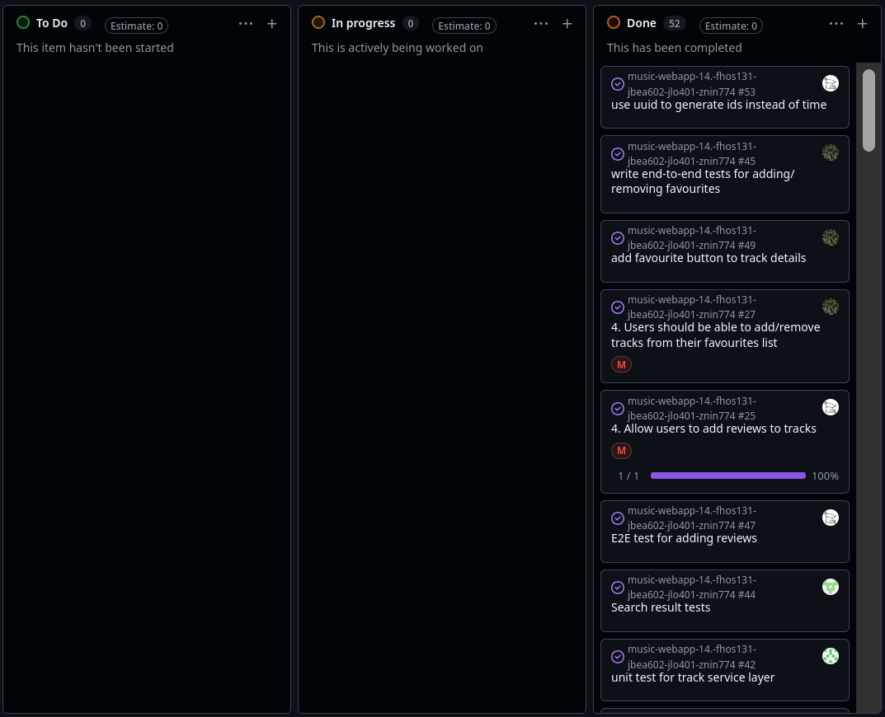

# Weekly Checkin 05

**Team Name:** (fhos131-jbea602-jlo401-znin774)

**GitHub Repo Link:** https://github.com/UoA-CS-Project-CS235-S2-2026/music-webapp-14.-fhos131-jbea602-jlo401-znin774

**Submitted by:** Joshua Lo

**Team Members (name + GitHub handle):**
- Finn — @BlueFinnTuna
- Joshua — @odmot
- Jono — @JonoBeach
- Zhuoyi — @ning12-3

**Participants this week:** Everyone has worked on the assignment this week

**How we synced:** Discord both on chat and on call.

## Discussion / Decisions
- Deciding how we want users to be able to filter search results
- Discussed the styling of the browse tracks page
- Fixed a pytest error
- Discussed adding more E2E tests
- Deciding to remove an unneeded button from the navbar
- Discussing whether we meet the requirements
- Discussing the styling of the track details page
- Discussing the styling of the homepage
- Deciding what font we want for the website

## Action Items
| Task | Owner | Due | Linked Issue | Status |
|---|---|---|---|---|
| change auth error message to not say user with this name doesn't exist | Finn | | [#51](https://github.com/UoA-CS-Project-CS235-S2-2026/music-webapp-14.-fhos131-jbea602-jlo401-znin774/issues/51) | To Do |
| Finish the browse (and search) page | Jono | Sep.10 | [#59](https://github.com/UoA-CS-Project-CS235-S2-2026/music-webapp-14.-fhos131-jbea602-jlo401-znin774/issues/59) | Done |
| Design for track display needed | Jono | Sep.10 | [#58](https://github.com/UoA-CS-Project-CS235-S2-2026/music-webapp-14.-fhos131-jbea602-jlo401-znin774/issues/58) | Done |
| Replace placeholder text | Jono | Sep.10 | [#57](https://github.com/UoA-CS-Project-CS235-S2-2026/music-webapp-14.-fhos131-jbea602-jlo401-znin774/issues/57) | Done |
| Group tests in classes | Ning | Sep.10 | [#54](https://github.com/UoA-CS-Project-CS235-S2-2026/music-webapp-14.-fhos131-jbea602-jlo401-znin774/issues/54) | Done |
| use uuid to generate ids instead of time | Joshua | Sep.10 | [#53](https://github.com/UoA-CS-Project-CS235-S2-2026/music-webapp-14.-fhos131-jbea602-jlo401-znin774/issues/53) | Done |
| Review rating should be from 1-5 inclusive | Finn | Sep.10 | [#52](https://github.com/UoA-CS-Project-CS235-S2-2026/music-webapp-14.-fhos131-jbea602-jlo401-znin774/issues/52) | Done |
| unit test for favourite service layer | Ning | Sep.10 | [#50](https://github.com/UoA-CS-Project-CS235-S2-2026/music-webapp-14.-fhos131-jbea602-jlo401-znin774/issues/50) | Done |
| add favourite button to track details | Finn | Sep.10 | [#49](https://github.com/UoA-CS-Project-CS235-S2-2026/music-webapp-14.-fhos131-jbea602-jlo401-znin774/issues/49) | Done |
| E-to-E test for track detail, search and browse | Ning | Sep.10 | [#48](https://github.com/UoA-CS-Project-CS235-S2-2026/music-webapp-14.-fhos131-jbea602-jlo401-znin774/issues/48) | Done |
| E2E test for adding reviews | Joshua | Sep.10 | [#47](https://github.com/UoA-CS-Project-CS235-S2-2026/music-webapp-14.-fhos131-jbea602-jlo401-znin774/issues/47) | Done |
| write end-to-end tests for adding/removing favourites | Finn | Sep.10 | [#45](https://github.com/UoA-CS-Project-CS235-S2-2026/music-webapp-14.-fhos131-jbea602-jlo401-znin774/issues/45) | Done |
| Search result tests | Jono | Sep.10 | [#44](https://github.com/UoA-CS-Project-CS235-S2-2026/music-webapp-14.-fhos131-jbea602-jlo401-znin774/issues/44) | Done |
| Styling for Track detail page | Joshua | Sep.10 | [#43](https://github.com/UoA-CS-Project-CS235-S2-2026/music-webapp-14.-fhos131-jbea602-jlo401-znin774/issues/43) | Done |
| unit test for track service layer | Ning | Sep.10 | [#42](https://github.com/UoA-CS-Project-CS235-S2-2026/music-webapp-14.-fhos131-jbea602-jlo401-znin774/issues/42) | Done |
| Username in sign in page is case sensitive | Joshua | Sep.10 | [#41](https://github.com/UoA-CS-Project-CS235-S2-2026/music-webapp-14.-fhos131-jbea602-jlo401-znin774/issues/41) | Done |
| user favourites page | Finn | Sep.10 | [#40](https://github.com/UoA-CS-Project-CS235-S2-2026/music-webapp-14.-fhos131-jbea602-jlo401-znin774/issues/40) | Done |
| When logged in replace sign up and login buttons with logout button | Finn | Sep.10 | [#39](https://github.com/UoA-CS-Project-CS235-S2-2026/music-webapp-14.-fhos131-jbea602-jlo401-znin774/issues/39) | Done |
| Link up login & register buttons in navbar | Finn | Sep.10 | [#38](https://github.com/UoA-CS-Project-CS235-S2-2026/music-webapp-14.-fhos131-jbea602-jlo401-znin774/issues/38) | Done |
| Create End-to-end tests for register/login | Finn | Sep.10 | [#35](https://github.com/UoA-CS-Project-CS235-S2-2026/music-webapp-14.-fhos131-jbea602-jlo401-znin774/issues/35) | Done |
| User-specific favourite track list| Finn | Sep.10 | [#27](https://github.com/UoA-CS-Project-CS235-S2-2026/music-webapp-14.-fhos131-jbea602-jlo401-znin774/issues/27) [#28](https://github.com/UoA-CS-Project-CS235-S2-2026/music-webapp-14.-fhos131-jbea602-jlo401-znin774/issues/28) |Done|
| Allow users to add reviews to tracks| Joshua | Sep.10 | [#25](https://github.com/UoA-CS-Project-CS235-S2-2026/music-webapp-14.-fhos131-jbea602-jlo401-znin774/issues/25) |Done|
|Registration and login/logout system|Finn|Sep.08| [#24](https://github.com/UoA-CS-Project-CS235-S2-2026/music-webapp-14.-fhos131-jbea602-jlo401-znin774/issues/24) [#29](https://github.com/UoA-CS-Project-CS235-S2-2026/music-webapp-14.-fhos131-jbea602-jlo401-znin774/issues/29) [#30](https://github.com/UoA-CS-Project-CS235-S2-2026/music-webapp-14.-fhos131-jbea602-jlo401-znin774/issues/30) [#34](https://github.com/UoA-CS-Project-CS235-S2-2026/music-webapp-14.-fhos131-jbea602-jlo401-znin774/issues/34) [#31](https://github.com/UoA-CS-Project-CS235-S2-2026/music-webapp-14.-fhos131-jbea602-jlo401-znin774/issues/31) |Done|
|Create initial webpages|Joshua|Sep.08| [#14](https://github.com/UoA-CS-Project-CS235-S2-2026/music-webapp-14.-fhos131-jbea602-jlo401-znin774/issues/14) [#15](https://github.com/UoA-CS-Project-CS235-S2-2026/music-webapp-14.-fhos131-jbea602-jlo401-znin774/issues/15) [#16](https://github.com/UoA-CS-Project-CS235-S2-2026/music-webapp-14.-fhos131-jbea602-jlo401-znin774/issues/16) [#32](https://github.com/UoA-CS-Project-CS235-S2-2026/music-webapp-14.-fhos131-jbea602-jlo401-znin774/issues/32) |Done|
|Display reviews and average rating on track detail page|Ning|Sep.08|[#26](https://github.com/UoA-CS-Project-CS235-S2-2026/music-webapp-14.-fhos131-jbea602-jlo401-znin774/issues/26)|Done|
|Show track details on selection|Ning|Sep.08| [#23](https://github.com/UoA-CS-Project-CS235-S2-2026/music-webapp-14.-fhos131-jbea602-jlo401-znin774/issues/23) |Done|
|Add dropdowns or selection options to search|Jono|Sep.08| [#22](https://github.com/UoA-CS-Project-CS235-S2-2026/music-webapp-14.-fhos131-jbea602-jlo401-znin774/issues/22) |Done|
|Search bar for searching tracks|Jono|Sep.08| [#21](https://github.com/UoA-CS-Project-CS235-S2-2026/music-webapp-14.-fhos131-jbea602-jlo401-znin774/issues/21) |Done|
|Create memory repository|Ning|Sep.06| [#17](https://github.com/UoA-CS-Project-CS235-S2-2026/music-webapp-14.-fhos131-jbea602-jlo401-znin774/issues/17) [#18](https://github.com/UoA-CS-Project-CS235-S2-2026/music-webapp-14.-fhos131-jbea602-jlo401-znin774/issues/18) [#19](https://github.com/UoA-CS-Project-CS235-S2-2026/music-webapp-14.-fhos131-jbea602-jlo401-znin774/issues/19) [#20](https://github.com/UoA-CS-Project-CS235-S2-2026/music-webapp-14.-fhos131-jbea602-jlo401-znin774/issues/20) [#33](https://github.com/UoA-CS-Project-CS235-S2-2026/music-webapp-14.-fhos131-jbea602-jlo401-znin774/issues/33)|Done|
|unit test fail - Album id should be lower case in \_\_repr\_\_|Joshua|Sep.06| [#11](https://github.com/UoA-CS-Project-CS235-S2-2026/music-webapp-14.-fhos131-jbea602-jlo401-znin774/issues/11)|Done|
|Unit test for Favourite class|Jono|Aug.30| [#8](https://github.com/UoA-CS-Project-CS235-S2-2026/music-webapp-14.-fhos131-jbea602-jlo401-znin774/issues/8) [#12](https://github.com/UoA-CS-Project-CS235-S2-2026/music-webapp-14.-fhos131-jbea602-jlo401-znin774/issues/12) [#13](https://github.com/UoA-CS-Project-CS235-S2-2026/music-webapp-14.-fhos131-jbea602-jlo401-znin774/issues/13) |Done|
|Unit test for Album class|Zhuoyi|Aug.30| [#7](https://github.com/UoA-CS-Project-CS235-S2-2026/music-webapp-14.-fhos131-jbea602-jlo401-znin774/issues/7) |Done|
|Unit test for each model||Aug.30| [#5](https://github.com/UoA-CS-Project-CS235-S2-2026/music-webapp-14.-fhos131-jbea602-jlo401-znin774/issues/5) |Done|
|Create album class|Zhuoyi|Aug.30| [#4](https://github.com/UoA-CS-Project-CS235-S2-2026/music-webapp-14.-fhos131-jbea602-jlo401-znin774/issues/4) |Done|
|Create a CSV reader|Joshua|Aug.30| [#1](https://github.com/UoA-CS-Project-CS235-S2-2026/music-webapp-14.-fhos131-jbea602-jlo401-znin774/issues/1) |Done|
|Unit tests not working|Joshua|Aug.28| [#9](https://github.com/UoA-CS-Project-CS235-S2-2026/music-webapp-14.-fhos131-jbea602-jlo401-znin774/issues/9) |Done|
|Create unit tests for Review class|Finn|Aug.28| [#6](https://github.com/UoA-CS-Project-CS235-S2-2026/music-webapp-14.-fhos131-jbea602-jlo401-znin774/issues/6) |Done|
|Finish favourite.py|Jono|Aug.28| [#3](https://github.com/UoA-CS-Project-CS235-S2-2026/music-webapp-14.-fhos131-jbea602-jlo401-znin774/issues/3) |Done|
|Create Review class|Finn|Aug.28| [#2](https://github.com/UoA-CS-Project-CS235-S2-2026/music-webapp-14.-fhos131-jbea602-jlo401-znin774/issues/2) |Done|

## Board Snapshot

